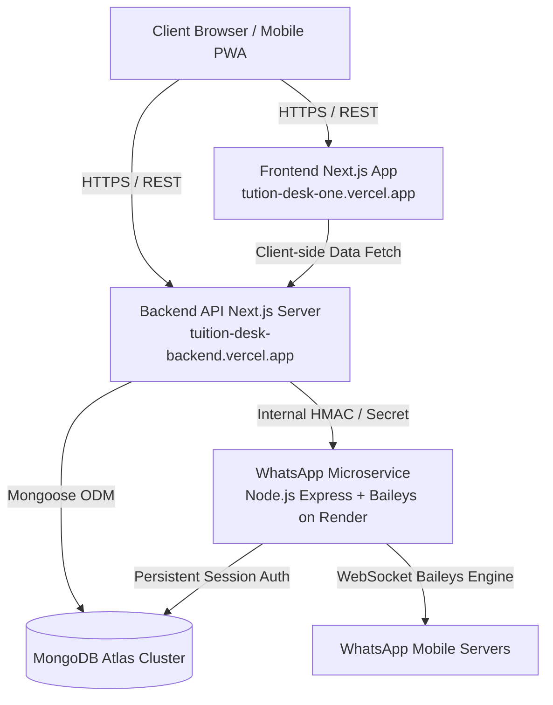

# TuitionDesk

> **Modern Tuition & Coaching Center Management Platform**
> Streamlined admissions, automated fee ledgers, UPI reconciliation, and multi-tenant WhatsApp communications.

---

## Overview

TuitionDesk is an all-in-one software solution tailored for tuition classes and coaching institutes. It eliminates manual bookkeeping, Excel-based attendance, and manual fee follow-ups by providing:

- **Centralized Institute Management**: Student roster, course batches, attendance tracking, and performance assessments.
- **Automated Fee Management**: One-click monthly fee ledger generation, automated fee reminders, partial payment reconciliation, and UPI magic links.
- **Dedicated WhatsApp Automation**: Built-in multi-tenant WhatsApp engine using Baileys to send personalized payment receipts, absence alerts, and fee notices directly to parents.
- **Parent Portal**: Lightweight, secure magic links enabling parents to view their ward's academic records, fee dues, and pay online without installing an app.

---

## System Architecture

TuitionDesk is built as a distributed, decoupled system consisting of three primary services:



---

## Repository Structure

```
d:/Tution Desk/
├── AGENTS.md                  # Mandatory operating guidelines for AI coding agents
├── README.md                  # This file
├── docs/                      # Complete system documentation library
│   ├── README.md              # Documentation navigation index
│   ├── 00-PROJECT-OVERVIEW.md # Comprehensive product breakdown
│   ├── 02-SYSTEM-ARCHITECTURE.md
│   ├── 08-WHATSAPP-INTEGRATION.md
│   └── ...                    # 17 detailed architecture documents
├── src/                       # Frontend application (Next.js 16, React 19, Tailwind CSS v4)
├── tution-desk-be/            # Backend API server (Next.js 16, Mongoose, Jose JWT)
├── whatsapp-server/           # Dedicated WhatsApp Baileys microservice (Express 4.21)
└── test/                      # System integration, security, and regression test suites
```

---

## Quick Start (Local Development)

### 1. Prerequisites
- Node.js `v20.x` or higher
- npm `v10.x` or higher
- MongoDB Atlas cluster URI or local MongoDB daemon

### 2. Microservice Port Allocations
| Subsystem | Directory | Default Port | Command |
| :--- | :--- | :--- | :--- |
| **Frontend UI** | `./` | `3000` | `npm run dev` |
| **Backend API** | `./tution-desk-be` | `3001` | `npm run dev` |
| **WhatsApp Engine** | `./whatsapp-server` | `3005` | `node index.js` |

### 3. Step-by-Step Setup

```bash
# 1. Install root dependencies (Frontend)
npm install

# 2. Install backend dependencies
cd tution-desk-be
npm install
cd ..

# 3. Install WhatsApp server dependencies
cd whatsapp-server
npm install
cd ..

# 4. Start all three services in separate terminals
# Terminal 1: WhatsApp Microservice
cd whatsapp-server && node index.js

# Terminal 2: Backend API
cd tution-desk-be && npm run dev

# Terminal 3: Frontend Web App
npm run dev
```

Visit `http://localhost:3000` in your browser.

---

## Testing & Quality Assurance

TuitionDesk maintains rigorous automated test suites across all layers:

```bash
# Run root system regression tests (Fee lifecycle, reconciliation, HTTP mappings)
node --test test/phase2a_fee_system.test.mjs test/fee_reminder_http_mapping.test.mjs

# Run WhatsApp microservice test suite (Baileys lifecycle, session recovery, timeouts)
cd whatsapp-server && npm test

# Typecheck backend and frontend
cd tution-desk-be && npx tsc --noEmit
cd .. && npx tsc --noEmit
```

---

## Documentation Library

For in-depth architectural details, API specifications, and operational policies, refer to the [`docs/`](./docs/README.md) directory:

- [Project Overview](./docs/00-PROJECT-OVERVIEW.md)
- [System Architecture & Flows](./docs/02-SYSTEM-ARCHITECTURE.md)
- [Backend Architecture & Data Access](./docs/04-BACKEND-ARCHITECTURE.md)
- [Database Schemas & Indexes](./docs/05-DATABASE-ARCHITECTURE.md)
- [API Reference Inventory](./docs/06-API-REFERENCE.md)
- [WhatsApp Microservice Architecture](./docs/08-WHATSAPP-INTEGRATION.md)
- [Security Audit & Vulnerability Registry](./docs/12-SECURITY-AUDIT.md)
- [Testing Strategy](./docs/14-TESTING-STRATEGY.md)

---

## Contributing & Agent Guidelines

All modifications must adhere strictly to the rules defined in [`AGENTS.md`](./AGENTS.md). AI coding agents and human developers must never bypass tenant isolation, send unverified WhatsApp messages, or expose production credentials.
