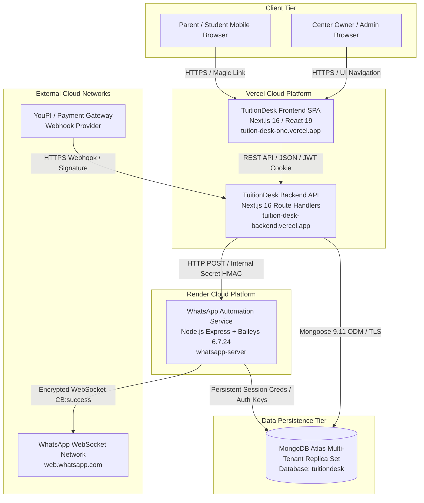
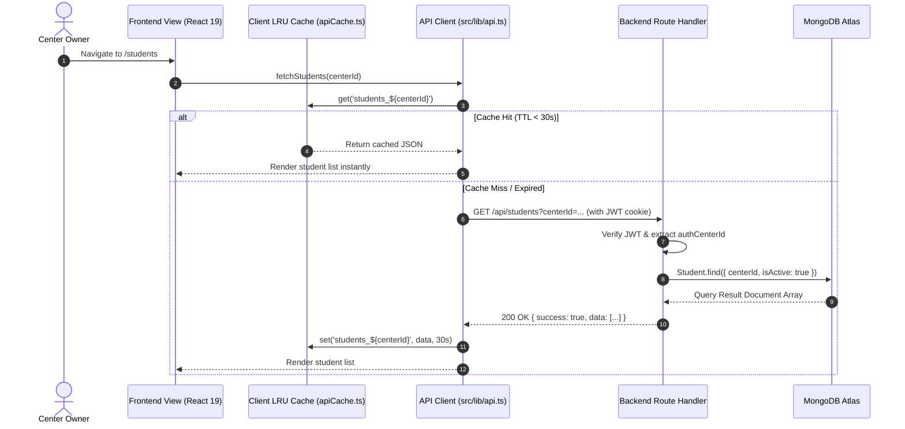
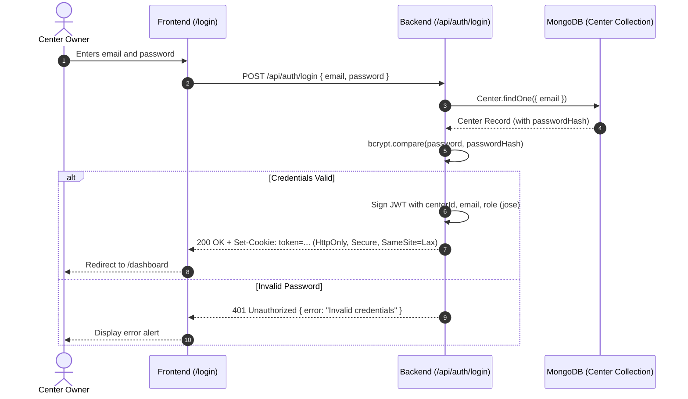
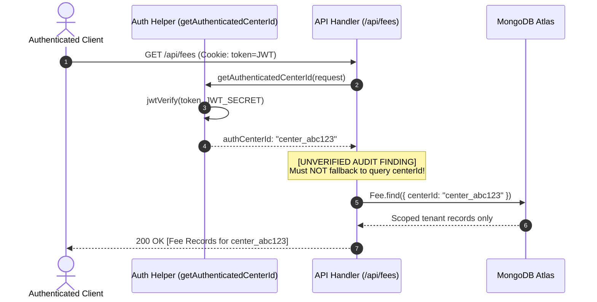
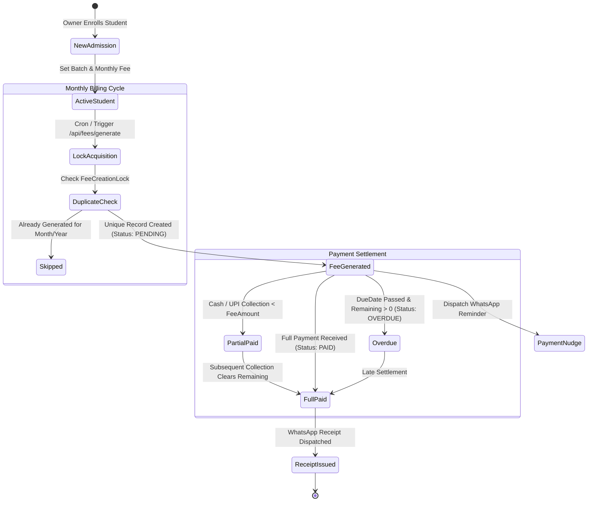
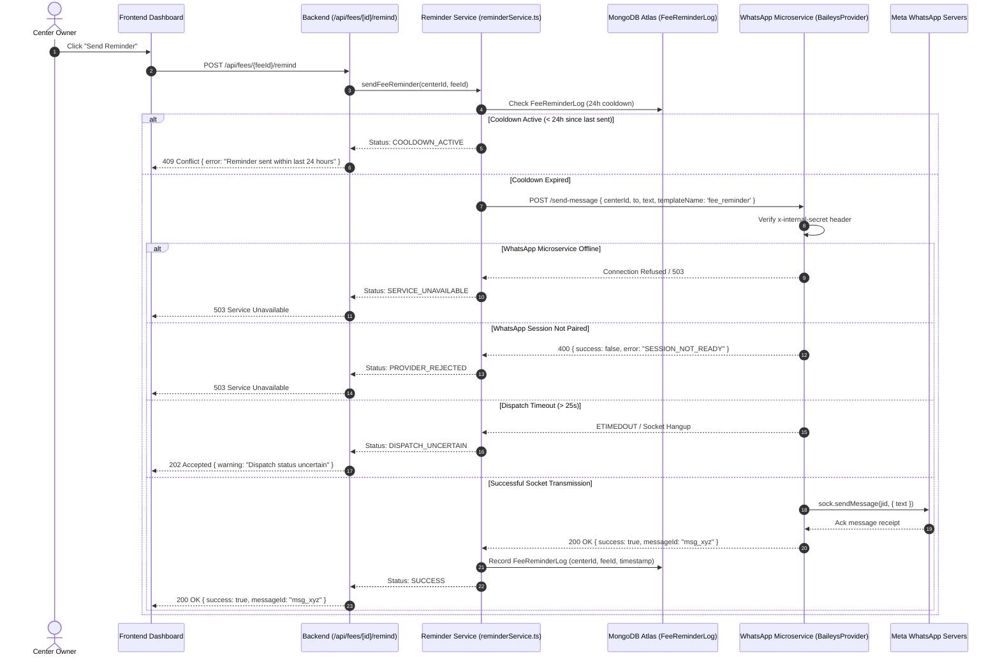

# 02 — System Architecture & Data Flows

*Last Reviewed: November 2026*
*Status: Authoritative Architectural Blueprint*

---

## 1. High-Level Architecture Topology

TuitionDesk is structured as a decoupled, multi-tier system composed of three discrete microservices:

1. **Frontend Client Application** (`/src`): Built with Next.js 16 (React 19, Tailwind CSS v4) hosted on Vercel (`tution-desk-one.vercel.app`). Provides the Single Page Application (SPA) dashboard for center owners and the public Parent Portal.
2. **Backend API Service** (`/tution-desk-be`): Headless Next.js 16 REST API route handlers hosted on Vercel (`tuition-desk-backend.vercel.app`). Handles business logic, authentication, Mongoose ODM connections, and data persistence.
3. **WhatsApp Engine Microservice** (`/whatsapp-server`): Express 4.21 server utilizing `@whiskeysockets/baileys` (v6.7.24) deployed on Render. Maintains persistent WebSocket connections with WhatsApp's servers, storing tenant authentication keys in MongoDB Atlas.

---

## 2. Mermaid Diagrams

### 2.1 Overall System Architecture

---

### 2.2 End-to-End Request Lifecycle & Client Caching

The frontend utilizes an in-memory LRU cache (`src/lib/apiCache.ts`) with a 30-second TTL to optimize owner dashboard navigation and reduce load on the backend serverless endpoints.

---

### 2.3 Authentication Lifecycle

Authentication relies on signed, HTTP-only JWT cookies generated via the `jose` library.

---

### 2.4 Multi-Tenant Data Isolation Flow

TuitionDesk uses logical (row-level) tenant separation within shared MongoDB collections, keyed by `centerId`.

---

### 2.5 Student Admission & Fee Ledger Lifecycle

---

### 2.6 WhatsApp Message Lifecycle & Failure Mapping

---

## 3. Network Ports & Communication Protocols

| Link | Origin | Destination | Protocol | Authentication |
| :--- | :--- | :--- | :--- | :--- |
| **Client to Frontend** | Web Browser | Vercel (Frontend) | HTTPS (TLS 1.3) | None (Public Assets) |
| **Client to Backend** | Web Browser | Vercel (Backend) | HTTPS (TLS 1.3) | HTTP-only JWT Cookie |
| **Backend to Database** | Vercel Serverless | MongoDB Atlas | MongoDB Wire Protocol / TLS | SCRAM-SHA-256 Credentials |
| **Backend to WhatsApp** | Vercel Serverless | Render Web Service | HTTPS / REST | Custom Header (`x-internal-secret`) |
| **WhatsApp to Database** | Render Container | MongoDB Atlas | MongoDB Wire Protocol / TLS | SCRAM-SHA-256 Credentials |
| **WhatsApp to Meta** | Render Container | WhatsApp Servers | Encrypted WSS (Baileys) | Noise Protocol / Curve25519 Keys |
