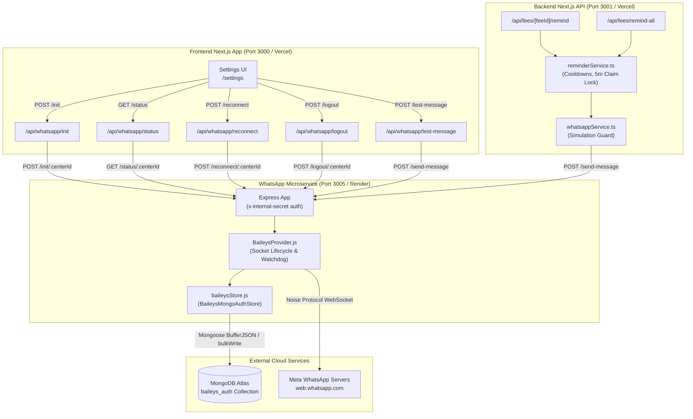
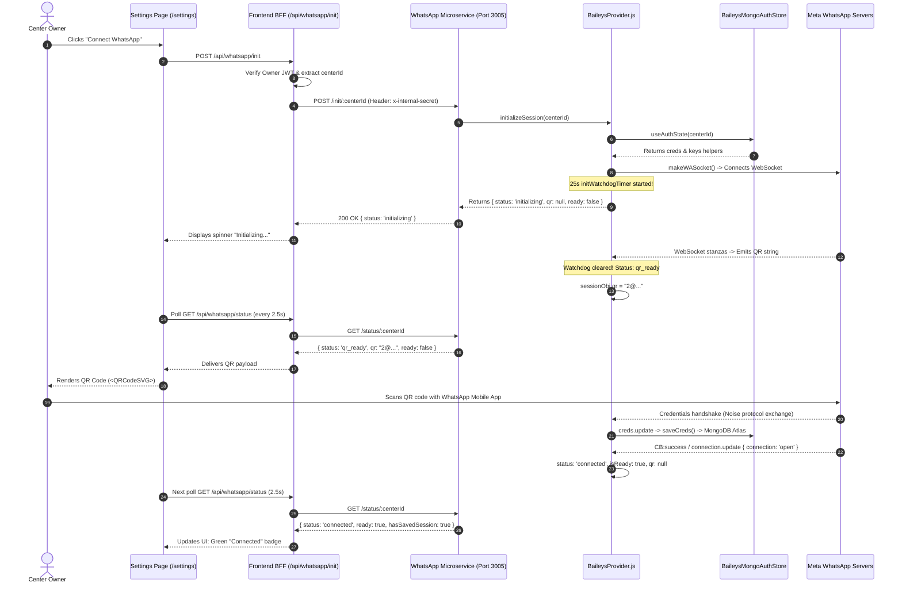

# 08 — WhatsApp Microservice & Baileys Automation Engine

*Last Reviewed: November 2026*
*Status: Authoritative Engineering Specification & Deep Architecture Trace*

---

## 1. Overview & Dual-Path Architecture Topology

The WhatsApp automation subsystem in TuitionDesk is implemented across two distinct communication paths:

1. **Frontend BFF Management Path (Settings & QR Pairing)**:
   - Client Browser $\rightarrow$ Frontend Next.js API (`src/app/api/whatsapp/*` on Port 3000) $\rightarrow$ WhatsApp Microservice (Port 3005).
   - Authenticates via owner JWT (`verifyOwnerRequest`), extracts `centerId`, and injects `x-internal-secret`.
   - Manages QR generation, polling status, manual reconnect, logout, and test ping.
2. **Backend Automated Dispatch Path (Fee Reminders & Receipts)**:
   - Backend Next.js API Handlers (`tution-desk-be/src/app/api/fees/*` on Port 3001) $\rightarrow$ `reminderService.ts` $\rightarrow$ `whatsappService.ts` $\rightarrow$ WhatsApp Microservice (Port 3005).
   - Validates center session, checks 24h cooldown, acquires 5-minute atomic claim lock on `Fee`, evaluates dual-flag simulation guard, and dispatches to `/send-message`.
3. **WhatsApp Microservice Container (`/whatsapp-server` on Port 3005)**:
   - Standalone Node.js Express service deployed on **Render**.
   - Protocol Engine: `@whiskeysockets/baileys` (v6.7.24).
   - Persistent Datastore: MongoDB Atlas collection `baileys_auth` (`BaileysMongoAuthStore`).



---

## 2. Active Execution Paths vs. Dead Code

During the architecture audit, an exact trace of imports and execution paths revealed:

| File | Status | Actual Usage |
| :--- | :--- | :--- |
| `tution-desk-be/src/lib/whatsappService.ts` | **ACTIVE** | Used by `reminderService.ts` and backend fee routes to dispatch live/simulated fee notices and welcome messages. |
| `src/lib/whatsappService.ts` | **PARTIALLY DEAD CODE** | Only `isLiveDispatchEnabled()` is imported by `src/app/api/whatsapp/test-message/route.ts`. The remaining functions (`sendFeeReminder`, `sendWelcomeMessage`, `sendTestResult`) are never called from frontend code. |
| `src/app/api/whatsapp/*` (12 BFF routes) | **ACTIVE** | Directly handles browser requests from `/settings` and proxies to the microservice on port 3005. |
| `whatsapp-server/providers/WWebJSProvider.js` | **INACTIVE / FALLBACK** | Legacy Puppeteer/Chromium engine. Only loaded if `WHATSAPP_ENGINE=wwebjs`. |
| `whatsapp-server/providers/BaileysProvider.js` | **ACTIVE** | Primary production engine. |

---

## 3. Session Lifecycle & QR Authentication Flow



---

## 4. Session Persistence in MongoDB Atlas (`baileysStore.js`)

All authentication credentials and cryptographic Signal keys are persisted in MongoDB Atlas under the collection `baileys_auth` (or configured collection):
- **Credential Document**: `{ centerId: "center-123", key: "creds", category: "creds", data: "{...JSON...}" }`
- **Signal Key Documents**: `{ centerId: "center-123", key: "pre-key:1", category: "pre-key", data: "..." }`
- **Serialization Safety**: Utilizes Baileys `BufferJSON.replacer` and `BufferJSON.reviver` to serialize Uint8Array/Buffer cryptographic keys losslessly.
- **Concurrency Queues**:
  - `_enqueueSave`: Serializes `saveCreds` calls per center via FIFO promise queues to prevent write race conditions.
  - `_enqueueKeySet`: Serializes `keys.set` via FIFO queue and batches updates using `bulkWrite({ ordered: false })`.
- **Compound Unique Index**: `{ centerId: 1, key: 1 }` guarantees zero cross-tenant key overwrites.

---

## 5. Reconnection Behavior & The Restart Problem

### 5.1 Auto-Reconnect on Boot (`AUTO_RECONNECT_ON_BOOT`)
In `BaileysProvider.js:147`:
```javascript
if (process.env.AUTO_RECONNECT_ON_BOOT === 'true' && process.env.NODE_ENV !== 'test') {
  const registeredCenters = await this.authStore.listRegisteredSessions();
  for (const regId of registeredCenters) {
    this.initializeSession(regId).catch(...);
  }
}
```
> [!WARNING]
> By default, `AUTO_RECONNECT_ON_BOOT` is unset. Therefore, when the microservice container restarts or redeploys on Render, **zero active WebSocket sockets are restored**. The sessions remain in MongoDB, but in-memory sockets do not exist until explicitly triggered by the user or by an incoming message.

### 5.2 On-Demand Rehydration in `sendMessage`
When a message send request arrives for an unspawned session, `BaileysProvider.sendMessage` attempts auto-rehydration:
1. Spawns socket: `this.initializeSession(targetCenterId)`.
2. Awaits readiness: Waits in a loop up to **6,000ms (6 seconds)**.
3. If the WebSocket handshake exceeds 6.0 seconds (e.g. cloud latency or DNS resolution), line 747 throws `ServiceUnavailableError`, failing the message dispatch even though the session is valid and connects moments later.

### 5.3 Baileys Stream Restarts (Code 515)
Meta's servers routinely close connections with code `515 (restartRequired)` immediately after pairing or key rotation.
`BaileysProvider.js:518` intercepts 515:
- Increments `sessionObj.restartCount` (up to `maxConsecutiveRestarts: 3`).
- Awaits `sessionObj.lastCredsSavePromise` to ensure newly received credentials are fully written to Atlas.
- Immediately schedules `_spawnSocket(cleanCenterId)` at `setTimeout(..., 0)`.
- Reconnects seamlessly using the newly persisted credentials.

### 5.4 Async `CB:success` Listener Wrapper
During handshake, Baileys emits an asynchronous `CB:success` event. Network timeouts during `sendPassiveIq` or `uploadPreKeysToServerIfRequired` reject with `Boom: Timed Out (408)`.
In commit `9423591`:
- Wrapped `sock.ws.rawListeners('CB:success')` preserving `this` via `listener.apply(sock.ws, args)`.
- Rejection is caught cleanly, invoking `sock.end(cbErr)` with fallback to `sock.ws.close()`.
- Eliminates unhandled promise rejections that crashed the Node process.

---

## 6. Message Dispatch State Machine & Simulation Guard

```mermaid
graph TD
    Trigger[1. Send Fee Reminder / Test Ping] --> CheckGuard{Dual Simulation Guard\nWHATSAPP_MODE === 'live' AND\nENABLE_LIVE_WHATSAPP === 'true'?}

    CheckGuard -->|No (Default)| SimOutput[Simulation Mode Active\nZero HTTP calls to port 3005\nReturns: sim-uuid\nLogs masked phone]

    CheckGuard -->|Yes (Both Set)| LiveHTTP[2. HTTP POST /send-message to Port 3005\nx-internal-secret attached]

    LiveHTTP --> MicroserviceCheck{Microservice Active?}
    MicroserviceCheck -->|Down / Timeout| Err503[HTTP 503 SERVICE_UNAVAILABLE]

    MicroserviceCheck -->|Online| SessionCheck{Session in Memory?}
    SessionCheck -->|No| Rehydrate{Saved in MongoDB?}
    Rehydrate -->|No| Unlinked[HTTP 503 SESSION_NOT_READY\nPlease scan QR in Settings]
    Rehydrate -->|Yes| Spawn[Auto-rehydrate Socket\nWait up to coldSessionTimeoutMs]

    Spawn --> ReadyCheck{isReady within timeout (default 15s)?}
    SessionCheck -->|Yes| ReadyCheck

    ReadyCheck -->|No (>15s)| TimeoutRej[HTTP 503 PROVIDER_REJECTED\nSession not ready within timeout]
    ReadyCheck -->|Yes| CheckNum{onWhatsApp Check}

    CheckNum -->|Not on WA| RejNotOnWA[HTTP 400 NOT_REGISTERED\nNumber not registered on WhatsApp]
    CheckNum -->|Registered| SendWS[3. sock.sendMessage(jid, text)\nTransmitted over WebSocket]

    SendWS --> SocketTimeout{Socket Times Out >10s?}
    SocketTimeout -->|Yes| Uncert[HTTP 202 DISPATCH_UNCERTAIN\n60m lock retained]
    SocketTimeout -->|No| ProvAck[4. Provider Accepted\nmessageId returned]

    ProvAck --> DBLog[5. FeeReminderLog Created\nstatus: provider_accepted]
```

---

## 7. Multi-Center Session Isolation Analysis

1. **Isolation Enforcement**:
   - Each center's Baileys session is keyed strictly by its sanitized, lowercased `centerId`.
   - In MongoDB, all documents are partitioned by `centerId`.
   - Microservice endpoints (`/status/:centerId`, `/init/:centerId`, `/reconnect/:centerId`, `/logout/:centerId`) enforce center scoping.
2. **Cross-Tenant Risk Resolved (Repair Batch 1 - Fix 2)**:
   - In previous revisions (`BaileysProvider.js:707-709`), an unkeyed request could fall back to a single active session in memory.
   - **Resolution applied**: Strict validation now throws `ValidationError('centerId is required in request body to route message to correct WhatsApp session.')` if `centerId` is missing, empty, or whitespace. No fallback is permitted. Regression-tested in `repair-batch-1-regression.test.js`.

---

## 8. Microservice HTTP Endpoint Inventory (Port 3005)

| Endpoint | Method | Auth Required | Purpose | Payload / Parameters | Responses |
| :--- | :--- | :--- | :--- | :--- | :--- |
| `/health` | `GET` | No | Orchestrator health check (Render). Reports persistence status & memory. | None | `200 OK` (Healthy), `503` (Degraded) |
| `/status` | `GET` | Yes (`x-internal-secret`) | Global diagnostics & summary of all tracked center sessions. | None | `200 OK` + Global stats JSON |
| `/status/:centerId` | `GET` | Yes | Status and active QR string for a specific center. | Param: `centerId` | `200 OK` { status, ready, qr, hasSavedSession } |
| `/init/:centerId` | `POST` | Yes | Idempotently initializes socket or returns current QR. | Param: `centerId` | `200 OK` { status, qr, ready } |
| `/reconnect/:centerId`| `POST` | Yes | Triggers reconnection; accepts `{ action: "new_pairing" }` to unlink. | Body: `{ action?: string }` | `200 OK`, `409 Conflict` (if initializing) |
| `/send-message` | `POST` | Yes | Dispatches outbound message through center's socket. | Body: `{ centerId, phone, message }` | `200 OK`, `400` (Validation), `503` (Not Ready) |
| `/logout/:centerId` | `POST` | Yes | Logs out from WhatsApp and deletes stored credentials from Atlas. | Param: `centerId` | `200 OK` |

---

## 9. Environment Variable Names (Configuration Manifest)

| Variable Name | Component | Expected Value / Format | Purpose |
| :--- | :--- | :--- | :--- |
| `WHATSAPP_ENGINE` | WhatsApp Microservice | `baileys` *(Default native engine)* | Selects active provider engine. Defaults to `baileys`; `wwebjs` is legacy opt-in. |
| `WHATSAPP_INTERNAL_SECRET` | All Subsystems | 256-bit Hex / Random String | Pre-shared key for authenticating inter-service requests on port 3005. |
| `WHATSAPP_SERVICE_URL` | Frontend & Backend | `http://localhost:3005` or Render private URL | HTTP URL pointing to the WhatsApp microservice. |
| `WHATSAPP_SERVER_URL` | Backend | `http://localhost:3005` or Render private URL | Secondary alias used by backend dispatcher. |
| `AUTO_RECONNECT_ON_BOOT` | WhatsApp Microservice | `true` or `false` (Default: true) | Restores registered sessions on microservice container boot with 500ms staggering. |
| `WHATSAPP_COLD_REHYDRATION_TIMEOUT_MS` | WhatsApp Microservice | Number (Default: 15000) | Timeout in ms waiting for cold Baileys socket handshake. |
| `WHATSAPP_MODE` | Backend & Frontend | `simulation` or `live` | Master operation mode. Set to `live` for actual outbound frames. |
| `ENABLE_LIVE_WHATSAPP` | Backend & Frontend | `true` or `false` | Secondary dual opt-in flag. Required along with `WHATSAPP_MODE=live`. |
| `PORT` | WhatsApp Microservice | `3005` | Local/Render listening port. |
| `WHATSAPP_HOST` | WhatsApp Microservice | `127.0.0.1` (Dev) / `0.0.0.0` (Container) | Network interface binding. |
| `MONGODB_URI` | WhatsApp Microservice | `mongodb+srv://...` | Connection URI for persisting Baileys auth keys in Atlas. |
