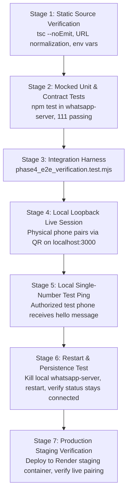

# 14 — Testing Strategy & Quality Assurance Architecture

*Last Reviewed: November 2026*
*Status: Authoritative Testing Framework & WhatsApp Verification Plan*

---

## 1. Overview & Testing Philosophy

TuitionDesk enforces a multi-tier testing strategy combining native Node.js test runners (`node --test`), TypeScript compiler verification (`tsc --noEmit`), and mock integration harnesses.

Because the system manages financial ledgers and external WhatsApp communication, testing adheres to two non-negotiable boundaries:
1. **Simulation Guard**: Tests must run with `WHATSAPP_MODE=simulation` and `ENABLE_LIVE_WHATSAPP=false`. Zero real WhatsApp packets may be sent to cellular networks during automated suites.
2. **Database Scoping**: Tests that interact with MongoDB must use mocked memory stores or strictly isolated staging databases (`tuitiondesk_staging`). Never run test scripts against production connection strings.

---

## 2. Test Suites Catalog

### 2.1 System & Fee Lifecycle Tests (`test/`)
Located in the repository root, executed via native Node.js:

| Test File | Focus Area | What It Actually Proves | What It Does NOT Prove |
| :--- | :--- | :--- | :--- |
| `phase2a_fee_system.test.mjs` | Monthly fee billing & status transitions | Proves fee calculation, overdue logic, and status state machine (`Pending`, `Paid`, `Partial Paid`). | Does not prove concurrent database locks under distributed network load. |
| `phase2i_concurrency_fix.test.mjs` | Concurrency locks (`FeeCreationLock`) | Proves duplicate monthly fee generation runs throw duplicate key errors and fail safely. | Does not prove behavior if Atlas unique index is absent (`autoIndex: false`). |
| `phase2c_manual_collection.test.mjs` | Cash collection & partial payments | Proves that manual payments correctly update `paidAmount` and `remainingAmount`. | Does not test UI modal interactions. |
| `phase2c_youpi_webhook.test.mjs` | Payment gateway reconciliation | Proves that valid webhook payloads trigger fee status updates to `Paid`. | Does not test actual YouPI bank callbacks or network timeouts. |
| `fee_reminder_http_mapping.test.mjs` | Reminder HTTP status code mapping | Proves that `reminderService` result codes map to HTTP 200, 202, 409, 503 as specified. | Does not prove WhatsApp socket transmission. |
| `fee_whatsapp_validation.test.mjs` | Amount validation & reminder trigger | Proves fee generation inputs (`min="1"`, `step="any"`), simulation guard, and reminder parameter formatting. | Does not test physical WhatsApp socket delivery. |
| `phase4_e2e_verification.test.mjs` | End-to-end integration mapping | Validates multi-tenant isolation, phone sanitization, 24h cooldown, and error propagation. | Does not test real cellular carriers. |
| `phase2d_cron_security.test.mjs` | Cron endpoint authorization | Proves `/api/cron/*` endpoints reject requests lacking `CRON_SECRET`. | Does not test external Vercel Cron invocation schedules. |

---

### 2.2 WhatsApp Microservice Tests (`whatsapp-server/test/`)
Executed via `npm test` inside `whatsapp-server/` (121 tests passing across 8 suites):

| Test File | Focus Area | What It Actually Proves | What It Does NOT Prove |
| :--- | :--- | :--- | :--- |
| `baileys-provider.test.js` | Baileys engine lifecycle | Proves QR emission, session initialization, 515 reconnect, and 408 clean disconnect without reconnect storm. | Does not prove pairing with real physical mobile devices. |
| `repair-batch-1-regression.test.js` | Repair Batch 1 (Fix 1 - Fix 6) | Proves default engine selection (`baileys`), strict `centerId` routing (no single-session fallback), startup session restoration with staggered queue, configurable cold rehydration wait, and unscanned QR timeout cleanup. | Does not test live cellular packet latency or carrier network delivery. |
| `session-recovery-regression.test.js` | `CB:success` error wrapping & cleanup | Proves that promise rejections during handshake are caught, `this` context is preserved, and cascading cleanup occurs. | Does not test cellular network latency or carrier packet drops. |
| `api-contract.test.js` | Microservice HTTP contracts | Proves `POST /init`, `GET /status`, `POST /send-message` enforce `x-internal-secret`. | Does not test external public internet accessibility. |
| `persistence.test.js` | MongoDB credential storage | Proves Baileys auth keys are serialized and retrieved from MongoDB collections. | Does not test MongoDB Atlas failover during active writes. |
| `baileys-persistence.test.js` | `BaileysMongoAuthStore` FIFO queues | Proves atomic serialization of `saveCreds` and `keys.set` using FIFO promise queues. | Does not test distributed multi-instance writes. |
| `engine-selection.test.js` | Engine selector & fallback | Validates switching between `baileys` and `wwebjs` based on `WHATSAPP_ENGINE`. Defaults strictly to `baileys`. | Does not test Chromium memory consumption. |
| `frontend-integration-mapping.test.js` | Frontend BFF status contracts | Proves status mapping, QR payload preservation, and stale in-flight response rejection. | Does not test client-side React rendering. |
| `baileys-outbound-dispatch.test.js` | Outbound message pipeline | Validates JID formatting, registration verification via `onWhatsApp`, and message send result payload. | Does not test real Meta server ACK packets. |

---

## 3. WhatsApp-Specific Acceptance Criteria

For any WhatsApp feature or bug fix to be considered ready for production, it must meet the following criteria:

| Scenario | Acceptance Criteria |
| :--- | :--- |
| **New QR Pairing** | `POST /init` spawns socket within 2500ms; `GET /status` returns valid QR string; scanning via mobile app transitions session to `connected` with `ready: true`; credentials written to MongoDB Atlas `baileys_auth`. |
| **Microservice Restart** | After process termination or container redeploy, previously registered sessions are automatically restored or cleanly rehydrated within 10 seconds without requiring QR rescan. |
| **Stream Restart (Code 515)** | When WhatsApp server triggers code 515, provider waits for credentials persistence and re-spawns socket immediately; session transitions back to `connected` without user intervention. |
| **Outbound Message Send** | `POST /send-message` validates phone number (10–15 digits); normalizes to JID (`91...@s.whatsapp.net`); verifies registration on WhatsApp; transmits socket frame; returns `status: "accepted"` with unique `messageId`. |
| **Simulation Guard** | When `WHATSAPP_MODE !== "live"` or `ENABLE_LIVE_WHATSAPP !== "true"`, dispatches return `simulated: true`, zero network requests reach port 3005, and logs mask recipient numbers. |
| **Multi-Tenant Isolation** | Two distinct centers (`center-a` and `center-b`) have completely separate sockets and MongoDB credential keys. Neither center can inspect status, disconnect, or send messages using the other center's session. |

---

## 4. Staged Verification & Rollout Plan

To ensure WhatsApp functionality without risking unverified cellular spam:

1. **Stage 1 (Static)**: Verify TypeScript types and environment variable bindings.
2. **Stage 2 (Mocked Unit)**: Run existing 111 microservice tests in `whatsapp-server/test/`.
3. **Stage 3 (Integration)**: Run root integration suites (`fee_reminder_http_mapping.test.mjs`, `fee_whatsapp_validation.test.mjs`).
4. **Stage 4 (Local QR Pairing)**: Start local microservice (`127.0.0.1:3005`), scan QR on `/settings`, verify session saves in Atlas.
5. **Stage 5 (Single Live Ping)**: Enable `WHATSAPP_MODE=live` with owner's explicit authorized personal test phone number. Confirm message arrives on handset.
6. **Stage 6 (Restart Resilience)**: Terminate microservice process (`Ctrl+C`), restart `node index.js`, verify session restores without re-scanning QR.
7. **Stage 7 (Production Deployment)**: Deploy verified build to Render, verify container health check `/health`, and test single reminder dispatch.
