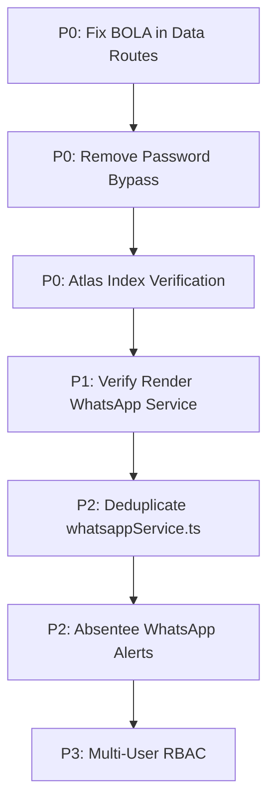

# 15 — Development Roadmap & Engineering Priorities

*Last Reviewed: November 2026*
*Status: Proposed Engineering Strategy (Awaiting Product Approval)*

---

## 1. Overview & Planning Principles

This roadmap provides a prioritized action plan for engineering teams and AI coding agents. It organizes tasks into five priority tiers based on security exposure, data integrity, operational reliability, and user value.

> [!NOTE]
> This roadmap represents a technical recommendation derived from the comprehensive architecture audit. It is a proposed strategy and does not authorize active development until explicit user approval is granted.

---

## 2. Priority Tiers Breakdown

### 🚨 P0 — Critical Security & Data Integrity (Immediate Priority)
Items that protect tenant isolation, prevent data breaches, and ensure database consistency:

1. **Remediate Broken Object Level Authorization (BOLA) in Data Routes (`SEC-BOLA-01`)**:
   - Strictly enforce `getAuthenticatedCenterId(request)` across `students/route.ts`, `fees/route.ts`, `attendance/route.ts`, `batches/route.ts`, and `tests/route.ts`.
   - Remove fallback to client-supplied `?centerId=...`.
2. **Remove Default Password Bypass in Login (`SEC-AUTH-02`)**:
   - Eliminate `"password123"` and `"123456"` bypass lines in `auth/login/route.ts:41-48`.
3. **Mask Parent Phone Numbers in Parent Portal (`SEC-PRIV-03`)**:
   - Sanitize `parentWhatsApp` in `parent/[studentId]/route.ts` (e.g. `******1234`).
4. **Enforce Production Database Indexes (`SEC-DATA-05`)**:
   - Execute a pre-flight index creation migration on MongoDB Atlas to ensure unique constraints on `FeeCreationLock` and compound indexes are provisioned.

---

### ⚠️ P1 — Core Broken Functionality & Reliability
Items that fix known operational failures or broken integration links:

1. **Verify Render WhatsApp Container Deployment**:
   - Inspect Render dashboard to verify commit `9423591` is active and healthy.
2. **Timing-Safe WhatsApp Microservice Secret Check (`SEC-AUTH-04`)**:
   - Replace standard equality with `crypto.timingSafeEqual`.
3. **Backend CORS Production Lock (`SEC-CONF-06`)**:
   - Fail closed if `ALLOWED_ORIGINS` is missing in staging or production.

---

### 🛠️ P2 — Incomplete Product Workflows
Items that close product gaps observed in existing UI or endpoints:

1. **Implement Automated Absentee WhatsApp Alerts**:
   - Wire the frontend attendance toggle to trigger a background WhatsApp notice via `reminderService` when a student is marked Absent.
2. **Deduplicate `whatsappService.ts`**:
   - Consolidate the 460-line duplicated file across Frontend and Backend into a single shared service layer or route all dispatches through backend endpoints.
3. **Deduplicate JWT Verification Utilities**:
   - Consolidate `src/lib/jwt.ts` and `tution-desk-be/src/lib/jwt.ts`.

---

### 📈 P3 — UX & Operational Improvements
Enhancements to administrative efficiency and frontend performance:

1. **Role-Based Access Control (RBAC)**:
   - Introduce `Staff` user accounts with limited permissions (Attendance marking, test marks entry) without revealing financial revenue or fee settings.
2. **Bulk Roster Import/Export**:
   - Support CSV import for student rosters and batch assignments.
3. **Automated WhatsApp PDF Receipts**:
   - Generate digital PDF payment receipts upon settlement and send as WhatsApp document attachments.

---

### 🚀 P4 — Future Product Capabilities
Long-term vision items:

1. **Interactive WhatsApp Chatbot**:
   - Parent self-service bot responding to queries like "FEES", "ATTENDANCE", or "SCHEDULE".
2. **Multi-Branch Hierarchy**:
   - Support institute owners operating multiple geographical branches under a single master organization account.
3. **Biometric & RFID Attendance**:
   - Direct integration with hardware scanners at tuition center entry gates.

---

## 3. Dependency Graph & Unresolved Decisions

### Unresolved Architectural Decisions:
- **ADR-001**: Should the WhatsApp microservice remain a standalone Express service on Render, or migrate to a containerized long-running worker on AWS ECS / Fly.io?
- **ADR-002**: Should the Parent Portal require mobile OTP verification before displaying test marks, or remain zero-login for maximum parent adoption?
